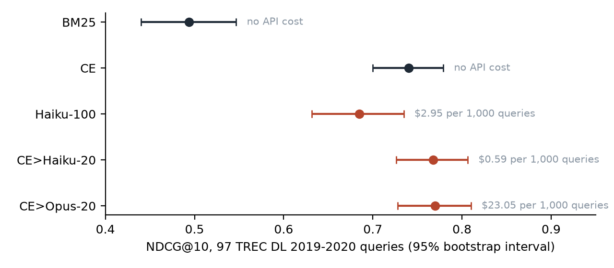
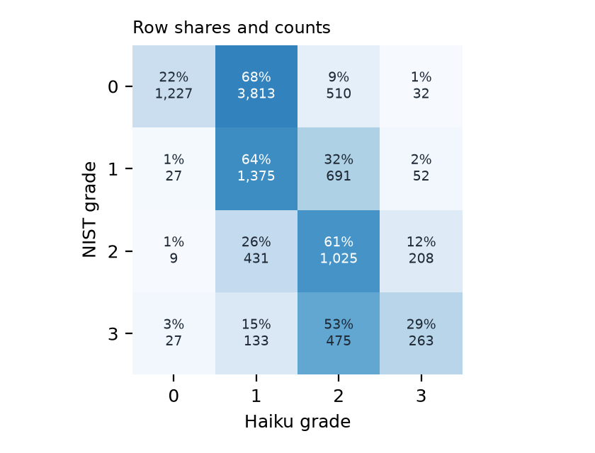
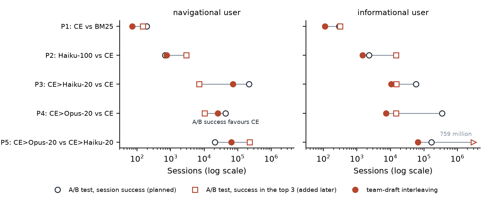

# Readout

Everything below follows [design.md](design.md), which was committed before any ranking was scored. Analyses added after the planned run are marked **post hoc** and do not change a verdict.

Claude Haiku 5.5 graded 15,144 query-passage pairs and Claude Opus 5.5 graded 2,623, all through the Message Batches API. Every request returned a grade that parsed. None needed a retry and none was counted as grade 0 after a failure. The main batches cost $3.49 and the pilot about $0.10, against a $30 cap.

## Verdicts

| | Prediction | Result | Met |
|---|---|---|---|
| P1 | CE beats BM25 by at least 0.10 | +0.247 (95% CI 0.202 to 0.295) | yes |
| P2 | Haiku-100 is not worse than CE by more than 0.03 | -0.056 (-0.084 to -0.028) | **no** |
| P3 | CE→Haiku-20 beats CE | +0.027 (0.013 to 0.042) | yes |
| P4 | CE→Opus-20 beats CE | +0.030 (0.013 to 0.046) | yes |
| P5 | CE→Opus-20 beats CE→Haiku-20 | +0.002 (-0.014 to 0.020) | **no** |
| L1 | Haiku agrees with NIST, weighted kappa at least 0.40 | 0.345 (0.295 to 0.394) | **no** |
| L2 | Opus agrees with NIST better than Haiku | +0.037 (0.012 to 0.062) | yes |
| L3 | Haiku labels order 11 systems as NIST labels do, tau at least 0.80 | 0.891 | yes |
| L4 | Haiku labels inflate the Haiku reranker's gain | +0.053 (0.039 to 0.070) | yes |
| O1 | Interleaving needs at most 1/5 of the A/B sessions | 2 of 8 cases with navigational or informational users | **no** |
| O2 | Interleaving prefers the ranker NDCG prefers | 8 of 8 cases (perfect and navigational users) | yes |

Part 1 differences are in NDCG@10 over the 97 queries. All four comparisons with an interval that excludes 0 also have Holm-adjusted p-values of 0.001 or less.

Pipeline checks:

- **K1 passed.** The cross-encoder scored 0.7358 on TREC DL 2019, against 0.7430 on its model card.
- **K2 passed.** All 11 unit tests pass.
- **K3 passed.** All 80 pilot requests parsed.
- **K4 passed.** Total spending was about $3.59.
- **Power check failed.** The planned power check of the online-test formulas came out between 0.61 and 0.92 against the planned 0.75 to 0.85 (Part 3 explains why).

## Part 1: rankers and what they cost

| System | NDCG@10 | MRR@10 | Recall@100 | API cost per 1,000 queries |
|---|---|---|---|---|
| BM25 | 0.494 | 0.650 | 0.514 | none |
| CE | 0.741 | 0.878 | 0.653 | none |
| Haiku-100 | 0.685 | 0.825 | 0.514 | $2.95 |
| CE→Haiku-20 | 0.768 | 0.881 | 0.653 | $0.59 |
| CE→Opus-20 | 0.770 | 0.892 | 0.653 | $23.05 |

The cross-encoder took 598 seconds on a laptop CPU for 93,066 pairs, about 6 seconds per query for its median of 1,000 candidates. That time is not priced.

Claude on top of the cross-encoder's top 20 added about 0.03 NDCG@10. The Haiku and Opus gains did not differ (P5), so Opus cost 39 times as much for nothing measurable here. Haiku placed directly on BM25's top 100 lost to the cross-encoder (P2).

**Post hoc.** Most of the P2 loss comes from the first stage, not from Haiku. CE scores all 1,000 candidates, while Haiku-100 only sees BM25's top 100, which holds on average 51% of a query's relevant passages, against 65% in CE's top 100. On the same 100 passages, Haiku-100 minus CE scored -0.019 (-0.043 to 0.005, p = 0.13). Searching deeper is worth 0.037 to the cross-encoder itself (CE against CE on BM25's top 100). Haiku's four grades also leave many ties, which fall back to BM25 order. In 23 of the 97 queries every passage in Haiku-100's top 10 carries the same grade.

## Part 2: Claude as the judge

**Haiku's agreement with NIST fell short (L1).** The linear-weighted kappa was 0.345: 0.367 for 2019 and 0.309 for 2020. On the cruder question of grade 2 or more against less, kappa was 0.551. The disagreement is mostly leniency. Of the 5,582 pairs NIST graded 0, Haiku called 68% "related" (grade 1) and 10% grade 2 or 3. It also rarely gave the top grade: 29% of the passages NIST graded 3. Opus was better (L2) but made the same kind of error. On the 1,000-pair sample, it called 70% of the NIST-0 pairs grade 1.

**System orderings survived (L3).** Scored with Haiku labels instead of NIST labels on the same pool, the 11 systems kept their order except for three pairs (tau 0.891):

- CE→Haiku-20 and CE→Opus-20 swapped first and second place.
- Haiku-100 moved from fifth to third, ahead of CE and of CE on BM25's top 100.

These NDCG values use only the judged candidates, so they differ from Part 1.

**Haiku labels favour the Haiku reranker (L4).** Under NIST labels, CE→Haiku-20 gains 0.028 over CE on the pool. Under Haiku labels, the same rankings gain 0.081, about three times as much. The excess is 0.053 (0.039 to 0.070).

**Post hoc control.** The Opus reranker, judged by Haiku, shows an excess of only 0.008 (-0.007 to 0.024). The inflation is specific to grading a ranker with the model that built it. It is not a general taste of Haiku for LLM rankers. This matches the circularity Clarke and Dietz (2024) warn about.

## Part 3: how many sessions an online test needs

**Pre-registered results.** Planned sizes came from 200,000 simulated sessions per arm.

**O1 failed.** Among the four comparisons with a clear NDCG difference (P1 to P4), interleaving needed at most a fifth of the A/B sessions in only 2 of the 8 comparison and user pairs with navigational or informational users: P3 and P4 for informational users, at 5.5 and 33 times fewer. For navigational users the ratio was 0.9 to 2.6.

**The perfect user shows a gap in the plan.** A perfect user never stops after a click, so "session success" is zero under every ranker. The planned A/B metric cannot detect anything for that user. The verdict script counted those cases as met (an infinite ratio). They do not change O1.

**O2 held.** For perfect and navigational users, interleaving preferred the ranker with the higher NDCG@10 in all 8 cases, and it did for informational users as well.

**The power check failed.** The cause is the planning estimate, not the formulas. For P3 with navigational users, the true difference in success rate is 0.0021. 200,000 simulated sessions per arm estimated 0.0026, which sized the test 34% too small (power 0.61).

**Post hoc 1: sized from exact rates, the formulas hold.** The click model gives each ranker's rates exactly. Sized from those rates, all 20 checks (5 comparisons × 2 user types × 2 tests) gave power between 0.78 and 0.83.

**Post hoc 2: both planned A/B metrics ignore order.** Under a cascade model, the chance that a session ends with a satisfied click is 1 - ∏(1 - c_g s_g) over the ten results shown, and the chance of any click is 1 - ∏(1 - c_g). Both are products, so they depend on which passages are in the top 10, never on their order. A reranker that only reorders the top 10 is invisible to them.

This produced a wrong answer for navigational users in P4. CE→Opus-20 moves some passages from ranks 11 to 20 into the top 10, and the set it ends up with has a slightly lower success rate (0.962 against 0.967). An A/B test on session success would have shipped CE, while NDCG and interleaving both prefer CE→Opus-20.

**Success within the first three results does see order.** With that metric, the A/B test points the right way in all 8 clear cases. For the two LLM rerankers it needs 7,000 to 15,000 sessions, fewer than interleaving for navigational users (26,000 to 72,000) and about 1.4 to 2 times interleaving for informational users.

**What changed between comparisons was the kind of change being tested.** When one ranker brings in different passages (P2: BM25's top 100 against all 1,000), the order-blind success metric was the most sensitive A/B metric. When one ranker reorders the same short list (P3, P4), only an order-aware metric or interleaving could see it. Interleaving was never the least sensitive of the three and never pointed the wrong way, so it is the safe default when the kind of change is not known in advance.

## What a search team could take from this

1. **Placement.** Put the LLM after a trained reranker, on a short list. On a cheap first stage, its quality is capped by what that stage retrieves.
2. **Model size.** Haiku was enough here. It gave the same gain as Opus at $0.59 instead of $23 per 1,000 queries.
3. **Judging.** Do not judge an LLM reranker with labels from the same LLM. Haiku's labels tripled the Haiku reranker's gain while ranking the other systems almost as NIST did.
4. **Online metrics.** Choose online metrics that see order, or use interleaving. Session success alone would have chosen the wrong ranker in one comparison here.

## Limits

- **Small evaluation set.** 97 queries is the standard TREC DL set but a small one. The P3 and P4 intervals are about ±0.015 around +0.03.
- **One prompt, one run.** Grading was pointwise with one prompt and the model's default sampling, run once. Listwise prompts, few-shot examples and repeated runs were not tried.
- **Possible contamination.** MS MARCO passages and the TREC DL qrels are public and may be in the models' training data. The cross-encoder was trained on MS MARCO training queries, a different set.
- **Simulated clicks.** Clicks came from a model with grades from NIST, unjudged passages counted as irrelevant, and every query equally likely. The user parameters are this project's own choice. Real traffic has popular queries, position bias beyond the cascade model and noisier judgments of relevance. Earlier work on real search logs found interleaving far more sensitive than A/B metrics (Chapelle et al., 2012), so the A/B results here should be read as what the click model allows, not as a claim about live traffic.
